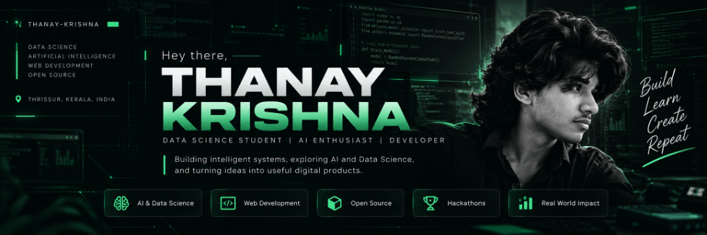

<!-- ========== HERO ========== -->

# 👋 Hey there, I'm Thanay Krishna

### Data Science Student · AI Enthusiast · Developer

Building intelligent systems, exploring AI, and turning ideas into useful digital products.

---

## 🧑‍💻 About Me

<table>
<tr>
<td width="60%" valign="top">

- 🎓 B.Tech CSE student specializing in Data Science
- 🧠 Interested in AI, machine learning, and predictive analytics
- 💻 Building web applications and intelligent systems
- 🌍 Exploring the intersection of software, data, and real-world problems
- 🚀 Hackathon participant and technology enthusiast
- 🤝 Open to interesting projects and collaboration

</td>
<td width="40%" valign="top">

### Current Focus

- ⚡ Patchwise development
- 🧠 AI and data-driven systems
- 🌐 Full-stack engineering
- 🔬 Building practical projects

</td>
</tr>
</table>

---

## ⚙️ Tech Stack

### Languages

### Frontend & Backend

### Cloud, Database & Tools

---

## 🚀 Featured Projects

<table>
<tr>
<td width="50%" valign="top">

### 🌍 BloomWatch Pro

An AI-powered biodiversity and flowering intelligence platform exploring environmental changes using Earth observation data.

**Highlights**
- 🌎 Interactive 3D Earth visualization
- 🧠 AI-powered species identification
- 📊 Predictive ecological insights

</td>
<td width="50%" valign="top">

### 🏥 MEDOS

**Medical Early Detection & Observation System**

A clinical monitoring and decision-support prototype designed to help visualize patient deterioration risks.

**Highlights**
- 📈 Patient vital-sign monitoring
- 🧠 Explainable risk assessment
- 🩺 Clinician-oriented decision support

</td>
</tr>
<tr>
<td width="50%" valign="top">

### 🛠️ Patchwise

An ongoing software engineering project focused on building a structured and reliable developer experience.

**Highlights**
- ⚙️ Backend foundation and APIs
- 🧪 Testing and stabilization
- 🖥️ Next.js dashboard development

</td>
<td width="50%" valign="top">

### 💡 More Projects

I also explore web development, data processing, IoT, and student-focused technology solutions.

Browse my repositories to discover more experiments, projects, and code.

</td>
</tr>
</table>

---

## 🏆 Achievements

<table>
<tr>
<td align="center" width="50%">

### 🌌 NASA Space Apps Challenge

🥇 **First Prize — Thrissur Local Event**

🌍 **Selected Global Nominee**

BloomWatch Pro · Earth and space science

</td>
<td align="center" width="50%">

### ⚡ SINOVA'26

🥇 **First Place — National Hackathon**

🏆 ₹30,000 prize

Recognized for innovation and problem-solving

</td>
</tr>
</table>

---

## 📊 GitHub Analytics

 

  

---

### 💬 A little about my journey

**Learn continuously. Build consistently. Innovate fearlessly.**

